  

  
  
  
  

I build full-stack products with LLMs inside — and make sure the AI can be trusted: knowledge-base guardrails, verified outputs, dry-runs before anything goes live.
Full-Stack Developer at **Landly** · B.Sc. Computer Science student at **HIT** · Shayetet 13 veteran · Israel.

## What I build

| Project | What it does | Stack | Links |
|---|---|---|---|
| **WhatsApp AI Customer-Service Bot** | Runs in production for a law firm: answers clients 24/7 from an approved knowledge base, hands off to the lawyer with the full transcript, and runs the lead flow end to end. | Node.js · Express · WhatsApp Cloud API · Claude / Gemini | [Code (sanitized)](https://github.com/SharonElimelech/whatsapp-ai-service-bot) |
| **JobPilot** | Autonomous job-search agent: scans 4 job sources every 2 hours, scores every posting against my CV with Claude structured outputs, Telegram alerts and a Next.js dashboard. | TypeScript · Node.js · Next.js · Supabase · GitHub Actions | [Code](https://github.com/SharonElimelech/jobpilot) |
| **MathGen** · co-founder | Worksheet generator for math teachers on 101,720 AI-generated exercises — SymPy verifies every answer before it ships. | Astro · TypeScript · Cloudflare Workers + D1 · Python · SymPy | Private beta |
| **Insolvency Case-Management CRM** | Offline-first CRM for a law firm: a desktop app with auto-backup and multi-PC sync, plus a cloud web edition. | Electron · React · TypeScript · SQLite · Supabase | [Cloud edition](https://github.com/SharonElimelech/crm-cloud) |
| **Math Tutor App** | PWA that runs my tutoring business: scheduling, push reminders, payments and income reports. | JavaScript · Service Workers · Cloudflare Workers | [Code](https://github.com/SharonElimelech/math-tutor-app) |

## Stack

  

**AI:** Claude, Gemini and OpenAI-compatible APIs · tool-calling agents · structured outputs · guardrails · n8n automations
